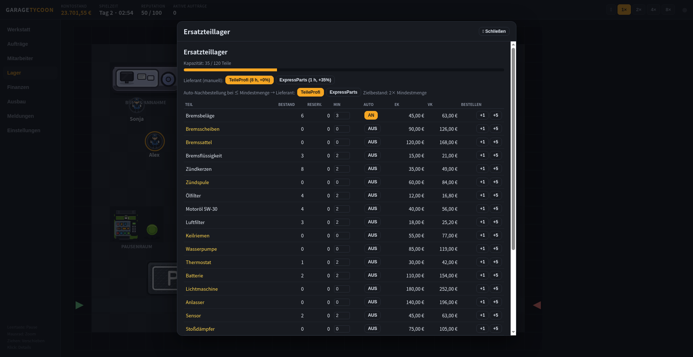

# Garage Tycoon

2D-Wirtschaftssimulation / Werkstattmanagement im Browser. TypeScript + Vite + PixiJS, vollständig offline. Spielstände werden primär in **IndexedDB** gespeichert (großer Browserspeicher, Fallback localStorage). Kein Backend.



## Spielen

Die jeweils aktuelle **`garage-tycoon.html`** aus dem [Release](../../releases/latest) herunterladen und im Browser öffnen – fertig. Keine Installation, kein Server nötig.

Alternativ lokal entwickeln:

```bash
npm install
npm run dev        # Entwicklungsserver
npm test           # Vitest-Suite (50 Tests)
npm run build      # statischer Build nach dist/
npm run build:single  # eine einzelne HTML-Datei nach dist-single/
```

## Gameplay

Du führst eine Kfz-Werkstatt: Aufträge annehmen, Mitarbeiter diagnostizieren und reparieren lassen, Ersatzteile beschaffen, Rechnungen schreiben und die Werkstatt ausbauen. Die Mitarbeiter handeln autonom (A*-Wegfindung, Aufgabenplanung nach Qualifikation/Priorität/Termin); du übernimmst Planung und Wirtschaft.

- 10 Fahrzeugmodelle, 23 datengetriebene Reparaturen, 23 Ersatzteile
- Diagnosesystem: Kundenmeldung ≠ tatsächliche Ursache
- Kostenvoranschläge mit Kundenfreigabe nach Budget und Kundenprofil
- Lager mit Reservierungen, zwei Lieferanten (Standard / Express), **Auto-Nachbestellung** unter Mindestmenge (Lager als Modal)
- **Personalverwaltung**: Kandidaten einstellen/entlassen (max. 6), **Weiterbildung** (+5 Skill für 150 €, 2 h)
- Finanzsystem in Cent-Beträgen mit Doppelbuchungsschutz, Gehältern, Fixkosten, Dashboard mit Tagesübersicht
- Reputation, Kundenzufriedenheit, Terminplanung
- Ausbau: dritte Hebebühne, Lagererweiterung
- Pause / 1× / 2× / 4× / 8×, Autosave, Savegame-Export/-Import, versionierte Migrationen

## Architektur

Strikte Trennung von Simulation und Rendering:

- `src/core/` – Spieluhr (Fixed-Timestep), Event-Bus, deterministischer RNG, SaveManager
- `src/simulation/` – Aufträge, Mitarbeiter, Reparaturen, Diagnose, Lager, Lieferanten, Kunden, Wirtschaft
- `src/world/` – Tile-Grid, A*-Wegfindung, Arbeitsplätze
- `src/rendering/` – PixiJS-Renderer (zeigt nur den Zustand, keine Spiellogik)
- `src/assets/sprites/` – handgezeichnete SVG-Sprites (Mechaniker, Fahrzeug, Hebebühne, Diagnosepad, Lager, Tresen, Parkplatz, Automat) im Cartoon-Stil der Vorlagen
- `src/ui/` – DOM-Panels (Aufträge, Mitarbeiter, Lager, Finanzen, Ausbau, Einstellungen)
- `src/persistence/` – localStorage-Adapter, Savegame-Validierung und -Migration
- `src/data/` – JSON-Definitionen (Fahrzeuge, Teile, Reparaturen, Lieferanten)
- `tests/` – Vitest: Statusmaschine, Reservierungen, Buchungen, Determinismus, Save-Roundtrip u. v. m.

Das vollständige Spielkonzept liegt in [`konzept.md`](konzept.md). Umgesetzt sind Phase 1 (spielbarer MVP) und die Kernfeatures von Phase 2 (Personalrekrutierung, Weiterbildung, automatische Lagerbestellungen, detaillierte Finanzübersichten).

## Releases

Bei jedem Versions-Tag (`v1.2.3` oder `1.2.3`) baut GitHub Actions automatisch:

1. `npm ci` + Tests
2. Single-File-Build (`garage-tycoon.html`)
3. Release mit der HTML-Datei als Asset

```bash
git tag v0.2.0
git push origin v0.2.0
```
